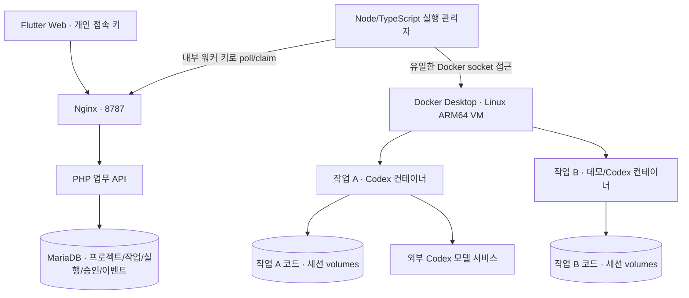
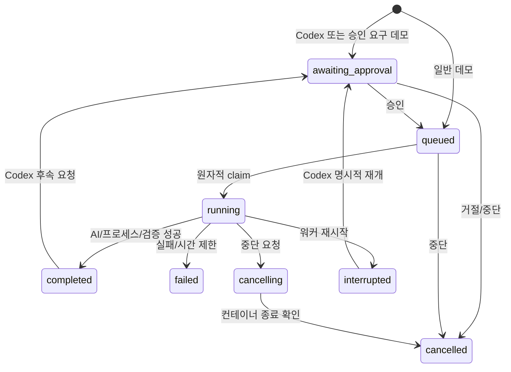

# Mate 상세 기획 · M1 검증 버전

작성: 2026-10-01. 이 문서는 제품 목표, 구현 범위, 데이터·API·실행 정책과 후속 일정을 구분한다. 현재 검증 결과는 `reports/M1-TEST.md`에 별도로 기록한다.

## 1. 제품 목표와 완료 기준

개인 사용자가 웹에서 AI 개발 작업을 맡기고, 브라우저를 닫았다가 다시 접속해 대화·진행·코드 변경·검증 결과를 확인한다. 같은 작업에 추가 요청을 보내면 코드와 해당 AI의 세션을 재사용한다. 작업 중단은 하위 명령까지 종료한다.

첫 설치 대상은 SSH 별칭 `m1`, `M1-MacBook-16.local`이다. 실제 장비는 Apple M1 Max, ARM64, RAM 64GB, macOS 26.5.2이며 이번 설치는 `~/apps/ai/mate`에 한정한다. 필고 웹 서버·DB·다른 프로젝트와 기존 컨테이너는 관리 대상에 포함하지 않는다.

첫 버전은 개인용이고 모델 추론은 외부 Codex 서비스가 담당한다. M1은 코드 작업과 명령·테스트를 실행한다. 이 설치만으로 로컬 LLM이나 GPU 추론 서버가 생기는 것은 아니다.

| 검증 시나리오 | 완료 조건 |
| --- | --- |
| 신규 작업 | 고유 작업 ID·실행 ID·환경과 기록 생성 |
| 실제 AI | Codex가 샘플 오류를 수정하고 실제 테스트 통과 |
| 연결 종료 후 복귀 | API에 저장된 이벤트·결과를 새 연결에서 조회 |
| 후속 입력 | 같은 작업·환경·Codex thread에서 추가 파일 수정 |
| 승인·거절 | 승인 전 컨테이너 실행 없음, 거절하면 종료 상태 |
| 중단 | 5초 정도 안에 작업 컨테이너와 모든 내부 프로세스 종료 |
| 워커 강제 재시작 | 기존 실행을 `interrupted`로 기록, 자동 재실행 없음 |
| 자원 격리 | 작업별 CPU·메모리·PID 제한, Docker socket 없음 |

## 2. 구조와 책임

- Flutter: 접속, 작업 목록, 작업 생성, 실행 승인, 진행 기록, diff, 검증, 실행 이력, 후속 요청·중단.
- PHP: 인증, 요청 검증, 상태 전이, 트랜잭션, 작업 배정과 영구 기록. Docker 명령이나 이미지·마운트를 웹에서 받지 않는다.
- MariaDB: 상태와 이벤트의 원본. 재접속 시 UI 기억에 의존하지 않는다.
- Worker: 큐 처리, 정해진 이미지로 컨테이너 준비, 인증 주입, 스트림 수집, 제한·중단·복구.
- 작업 컨테이너: 자기 작업의 코드와 세션만 읽는다. 관리자·DB·다른 코드 폴더의 mount를 받지 않는다.

Compose의 `control` 내부 네트워크에 상시 서비스를 둔다. Nginx만 외부 연결용 `edge`에도 연결하여 호스트의 8787 포트를 제공한다. Codex 컨테이너는 별도 bridge로 모델 서비스에 접속한다. 데모는 network none으로 실행한다. M1의 Docker Desktop은 Linux VM을 사용하므로 Xcode·macOS SDK 작업은 이 컨테이너에서 수행할 수 없다.

## 3. 화면과 사용자 흐름

1. 개인 접속 키 입력 또는 비공개 링크로 로그인한다. 키는 UI 메모리에서 사용하며 서버 데이터는 지속된다.
2. 프로젝트와 에이전트, 이름·목표를 지정해 작업을 생성한다. 현재 프로젝트 선택은 내장 Node 샘플 하나로 제한한다.
3. Codex는 승인 대기 상태가 된다. 사용자가 이번 실행의 격리된 코드 변경·명령·AI 접속 범위를 승인한다.
4. 진행 기록에서 AI 메시지, 명령과 결과, 파일 변경, 테스트 결과를 확인한다. 2초 주기 poll과 이벤트 cursor로 연결을 복원한다.
5. 완료 후 diff와 검증 출력을 읽는다. 성공은 프로세스·Codex turn 완료·실제 테스트 exit 0을 함께 확인한다.
6. 후속 요청은 같은 작업에 새 실행 기록을 만들고 기존 코드·세션을 재사용한다. Codex 실행마다 다시 승인한다.
7. 중단 요청은 DB에 먼저 보존한다. 워커는 해당 작업 컨테이너를 종료한다. 기록과 volume은 삭제하지 않는다.

현재 화면은 사용자가 지정한 목표를 작업 단위로 처리한다. 일반 대화를 분석해 프로젝트·에이전트·작업을 자동 선택하는 중앙 챗봇은 후속 구현이다. 실행 중 추가 입력은 순서 혼란을 피하기 위해 차단한다. 여러 독립 작업은 동시에 실행할 수 있다.

## 4. 데이터 모델

| 테이블 | 역할 | 주요 정보 |
| --- | --- | --- |
| projects | 저장소/실행 템플릿의 정의 | id, 이름, template |
| tasks | 목표와 이어지는 대화 | project, 제목, agent, 상태, session ID |
| runs | 요청 하나를 처리한 실행 | prompt, 상태, worker, 시작/종료, 취소 요청, 결과/diff/검증/usage |
| environments | 작업의 지속 작업 환경 | task, container name, 코드 volume, session volume |
| events | 순서 있는 진행 기록 | 증가 ID, task/run, type, JSON, 시각 |
| approvals | 실행 범위 승인 기록 | run, 이유, pending/approved/rejected, 결정 시각 |
| workers | 실행 관리자 상태 | ID, 아키텍처/자원/한도/인증 가능 여부, heartbeat |

프로젝트 ≠ 작업 ≠ 실행 ≠ 환경이다. 작업당 환경은 하나, 실행은 여러 개다. 작업이 완료되어도 환경은 남고 컨테이너만 정지한다. Codex auth와 rollout은 session volume에, 코드와 Git 이력은 workspace volume에 남는다. DB의 시간은 UTC로 저장한다. 현재 UI에서 원시 기록 시각을 보여 주며 사용자별 시간대 변환은 후속 기능이다.

## 5. 상태와 동시성

작업 row lock과 실행 row lock을 같은 순서로 획득한다. 큐 claim은 `FOR UPDATE SKIP LOCKED`를 사용한다. 승인 결정은 일회성이고 같은 작업에 실행 중 후속 요청을 만들지 못한다. 취소와 완료가 겹치면 잠금 후 저장된 취소 요청을 우선 반영한다.

작업에 표시되는 `cancelling`은 요청을 받았다는 뜻이며 실제 종료를 의미하지 않는다. 실행 기록은 프로세스를 종료한 뒤 `cancelled`로 마감한다. 완료 실행과 대기 실행은 재시작 시 그대로 보존한다.

## 6. API 계약

사용자 API는 개인 `MATE_TOKEN`, 워커 API는 별도 `WORKER_TOKEN`을 Bearer로 받는다. 서로의 키로 다른 역할 API에 접근할 수 없다. key·auth·DB 암호는 응답에 포함하지 않는다.

| Method / 경로 | 의미 |
| --- | --- |
| GET /api/health | 공개 최소 생존 확인 |
| GET /api/status | 호스트 상태·프로젝트·작업 목록 |
| POST /api/tasks | 작업/환경/첫 실행 생성 |
| GET /api/tasks/{id} | 작업·환경·실행·승인 조회 |
| GET /api/tasks/{id}/events?after={id} | 증가 cursor 이후 최대 200개 기록 |
| POST /api/tasks/{id}/turns | 같은 작업 후속 요청 |
| POST /api/tasks/{id}/cancel | 멱등적 취소 요청 |
| POST /api/approvals/{id} | 승인/거절, 중복 결정은 409 |
| POST /api/worker/heartbeat | 능력·자원·상태 보고 |
| POST /api/worker/claim | 하나의 실행 원자적 배정 |
| POST /api/worker/poll | 실행의 취소 요청 확인 |
| POST /api/worker/events | 이벤트와 세션 ID 기록 |
| POST /api/worker/finish | 결과·diff·검증·usage 저장 |
| POST /api/worker/recovery | 자기 호스트의 미종료 실행 조회 |

요청은 JSON, 에러는 `{error: string}`이다. 길이 제한과 에이전트 allowlist를 적용하고 SQL은 prepared statement로 실행한다. 프로젝트 템플릿은 서버가 정한다. 입력으로 임의 Docker 이미지, 실행 파일, host path, root/privileged 설정을 지정할 수 없다.

## 7. 에이전트 연결 모듈

현재 adapter는 컨테이너의 `agent/run.mjs`이며 `demo`와 `codex`를 지원한다. 관리자와의 입력은 JSON 한 줄, 출력은 표준 JSONL 이벤트다.

| 공통 이벤트 | 역할 |
| --- | --- |
| message/progress | 대화와 진행 |
| session | provider thread ID 지속 저장 |
| command | 명령·상태·출력·exit |
| file_change | 변경 파일·작업 종류 |
| usage | provider가 보고한 토큰 사용량 |
| verification | 실제 테스트 명령 결과 |
| result | 종료 상태·요약·diff·검증·usage |
| error/log | 실패 정보·진단 |

Codex CLI 버전은 `0.159.2`로 고정한다. 신규 실행은 `codex exec --json`, 후속 실행은 특정 thread ID의 `codex exec resume`을 사용한다. 기본 모델은 해당 계정의 CLI 기본값이며 `.env`의 `CODEX_MODEL`로 명시할 수 있다. 컨테이너 외부 격리를 적용하므로 Codex의 `danger-full-access` 범위는 비 root 작업 컨테이너 내부다.

실행 전 웹 승인은 실행 범위 전체에 대한 승인이다. `codex exec`의 명령별 승인 질문을 웹에서 중계하는 기능은 현재 제공하지 않는다. 그 기능은 별도 app-server stdio adapter로 추가한다. Claude Agent SDK adapter는 독립 session namespace를 사용하고 공통 이벤트로 변환할 예정이다. AI 전환 시 코드·목표·요약을 전달하고 세션을 혼합하지 않는다.

## 8. Docker와 인증 경계

- Docker socket은 worker에만 mount한다. 웹·API·DB·작업 컨테이너에는 없다.
- `mate.managed=task`와 작업 ID label을 검증하고 정해진 이름의 컨테이너·volume만 제어한다.
- 사용자 지정 host bind mount, privileged, root 실행, host network는 받지 않는다.
- 작업 runtime은 UID/GID 1000, read-only root, ALL capability drop, no-new-privileges, PID 256으로 제한한다.
- root bootstrap은 새 코드·세션 volume 초기화와 소유권 설정만 수행한다. 애플리케이션 에이전트는 root가 아니다.
- M1 기존 Codex 로그인은 사용자가 승인한 개인 테스트에만 사용한다. 호스트 config·hook·MCP 설정 전체를 복사하지 않는다.
- 인증 파일은 mode 600, 비밀 폴더는 mode 700, Git 제외다. task session에서 갱신된 auth를 유지한다.

개인 인증 파일은 작업 컨테이너 안의 AI 프로세스에서 사용할 수 있으므로 악성 코드로부터 완전히 분리된 비밀 프록시가 아니다. 현재는 신뢰할 수 있는 내장 샘플 전용이다. 외부/비신뢰 저장소와 여러 사용자에게 확장하기 전에는 short-lived credential 또는 API proxy와 egress 정책이 필요하다. bridge 네트워크의 LAN 접근 차단 역시 후속 범위다. 이번 버전은 배포·외부 서비스 쓰기를 도구 정책으로 강제 차단하지 않으며 샘플의 작업 지침과 승인 범위로 제한한다.

## 9. 자원·비용 정책

| 항목 | 첫 설치값 | 조정 방법 |
| --- | --- | --- |
| 동시 실행 | 2 | MAX_CONCURRENT, 1–8 |
| 작업 CPU | 2 | TASK_CPU |
| 작업 메모리/메모리+swap | 2GB/2GB | TASK_MEMORY |
| 작업 PID | 256 | 관리자 고정값 |
| 실행 시간 | 900초 | RUN_TIMEOUT_SECONDS |
| 로그 이벤트 | 실행당 5,000 | 관리자 고정값 |
| API body | 2MB | Nginx/PHP |
| DB/API/Web/Worker 메모리 | 768/256/128/384MB | Compose |

M1 호스트 RAM과 Docker VM에 할당된 RAM은 별개다. 실제 VM 메모리를 heartbeat에 기록하고 최대 동시 작업을 조정한다. 디스크는 첫 확인 당시 약 52GB 여유가 있어 작업 수·보존량을 정기적으로 확인한다. 현재 volume disk quota, 자동 retention/청소는 없다.

토큰 사용량은 기록하나 금액 환산·월 예산·토큰 hard stop은 아직 없다. wall time 제한은 비용 상한을 보장하지 않는다. 후속 단계에서는 provider 가격 버전, 작업별 예상/실제 비용, 월 한도, 초과 시 다음 turn 차단을 추가한다. 이미 진행 중인 단일 모델 호출의 엄격한 비용 상한은 provider별 제약을 따로 확인한다.

## 10. 장애와 복구

| 상황 | 동작 |
| --- | --- |
| 브라우저 종료/네트워크 단절 | worker 계속 실행, DB 이벤트 보존 |
| 재로그인 | 목록·작업 상세·cursor로 진행/결과 재조회 |
| 승인 대기 중 재시작 | 승인 row 유지, 사용자 결정 대기 |
| AI 오류/테스트 실패 | failed와 로그·diff·검증 결과 보존 |
| 사용자 중단 | cancel flag 기록 → worker가 container stop → cancelled |
| 실행 시간 초과 | 컨테이너 종료, failed로 이유 기록 |
| worker 재시작 | 자기 미종료 run의 컨테이너 종료, interrupted 기록 |
| Docker/Mac 재시작 | Compose 복귀 후 같은 recovery, 자동 prompt 재실행 없음 |

Docker restart 정책은 상시 서비스의 복귀에만 사용한다. 작업은 자동 재시작하지 않는다. 사용자 LaunchAgent `com.mate.personal-server`가 로그인 후 Docker Desktop을 시작하고 Compose를 기동한다. 로그인 전 완전 무인 복구는 이번 설치 범위가 아니다. 실제 OS 재부팅은 다른 앱에 영향을 주므로 테스트하지 않고 worker 강제 재시작으로 복구 경로를 검증한다.

중단된 작업은 저장된 파일과 session으로 새 실행을 생성해 명시적으로 재개한다. 외부 쓰기 중복 방지의 다음 단계는 operation ID, 승인 scope, 실행 ledger이며 자동 재시도하지 않는 현재 정책만으로 외부 작업의 원자성을 보장하지 않는다.

## 11. 단계별 구현 계획

| 단계 | 산출물 | 예상 노력 | 완료 기준 |
| --- | --- | --- | --- |
| 0 · 이번 검증 | 상세 설계, 단일 M1, 샘플 Codex/데모, 전체 작업 흐름 | 1차 구현 | 실제 수정/후속/중단/재접속/worker 복구 확인 |
| 1 · 프로젝트 연결 | Git URL allowlist, 프로젝트 CRUD, 별도 checkout, secret proxy | 3–5 개발일 | 실제 지정 저장소를 격리해 수정·diff export |
| 2 · 운영 강화 | HTTPS, 계정, 감사 기록, retention/backup, 한도·알림 | 3–5 개발일 | 재설치/복원·권한·동시성·디스크 한도 검증 |
| 3 · 대화형 에이전트 | 중앙 챗봇, Codex app-server, 명령별 승인 | 4–7 개발일 | 일반 대화로 작업 연결, approve/reject/interrupt 스트림 |
| 4 · Claude | Claude SDK, 에이전트별 세션과 공통 이벤트 | 2–4 개발일 | 두 provider에서 동일 작업 흐름 검증 |
| 5 · 다중 호스트 | 원격 등록, worker별 ID/키/lease, 능력 배정 | 4–7 개발일 | 두 호스트 배정·오프라인·lease fencing |
| 6 · 로컬 모델/macOS | Ollama native 지속 서버, GPU 능력, 별도 macOS worker | 실측 후 산정 | 모델 응답·자원·Xcode 실행 경로 검증 |

위 기간은 규모·AI 사용량·계정 정책에 따른 추정이며 일정 보장이 아니다. 이번 샘플 버전을 실제 비신뢰 프로젝트 운영으로 승격하지 않는다.

## 12. 검증 전략

정적 검증: Flutter analyze, TypeScript tsc, PHP lint, JSON/Compose 구문. 통합 검증은 실제 M1 API·DB·Docker에서 수행한다. 비용 없는 데모로 승인·취소·이력·격리·재접속을 반복 확인하고 실제 Codex로 코드 변경·테스트·세션 재개를 검증한다.

자동 smoke는 인증 실패, 역할 키 격리, 승인 거절과 중복 결정, 실행 중 후속 입력 차단, 실제 diff/테스트, cancel, workspace/session 재사용을 확인한다. 복구 테스트는 긴 데모 실행 중 worker 컨테이너만 SIGKILL 후 재시작한다. 필고나 다른 컨테이너의 restart/cleanup는 수행하지 않는다.

## 13. 공식 근거

- [Codex 비대화형 실행·JSONL·세션 재개](https://developers.openai.com/codex/noninteractive/): `exec --json`과 특정 session 재개를 adapter 기반으로 채택.
- [Docker CPU·메모리 제한](https://docs.docker.com/engine/containers/resource_constraints/): 기본 무제한을 피하고 task resource flag 명시.
- [Docker Desktop Mac 설치](https://docs.docker.com/desktop/setup/install/mac-install/): Apple silicon Docker 환경과 시작 전제.

구현 계약은 실제 M1에 설치된 CLI help와 고정된 컨테이너 이미지 버전으로 다시 검증한다.
